## Today {.smaller}

:::: {.columns}
::: {.column width="50%"}
**1:15–2:30 · Part 1: How numbers become evidence**

1. A short lecture on thinking quantitatively *(~22 min)*
   - Evidence, measurement, good questions
   - Correlation and variation
   - Correlation vs. causation
   - Where credible causal claims come from
   - Samples, uncertainty, inference
2. **Measure → Map → Model**: the three readings, discussed in small groups *(~40 min)*
3. Your question ladder *(~12 min)*
:::
::: {.column width="50%"}
**2:30–2:45 · Break**

**2:45–4:00 · Part 2: Hands-on lab**

- Summary statistics
- One good figure
- One statistical test

 

::: {.keyidea}
**The goal:** leave with a question your data paper can actually answer, and the tools to answer it.
:::
:::
::::

::: {.notes}
~1 min. Frame the day. Emphasize that the lecture is short and the rest is them talking. The break doubles as install troubleshooting time.
:::

## Where you are right now {.smaller}

From the pre-workshop survey (9 responses):

- **7 of 9** are still choosing a topic or have a focus but **no question yet**, and **6 of 9** haven't found a dataset. That is normal at this stage.
- Biggest obstacles: **narrowing the topic** and **turning a topic into a question data can answer** (5 of 9 each).
- Most comfortable *finding* data; least comfortable with **correlation and regression** (5 of 9: "not at all").
- Top interests: **major powers and small states (AOSIS)**, **environmental conflict**, **NDCs**; then climate finance, aid, IOs and North–South divides.
- **6 of 9** have used R before. Most plan to use Excel, Stata or haven't decided: today's ideas carry over to any tool.

::: {.activity}
**Today is built around those obstacles.** By the break you should have a draft question. By the end, a first look at data.
:::

::: {.notes}
~1 min. Survey as of Nov 17 (n = 9). Keep it aggregate; never single out individual responses. Also useful: 3 of 9 lean toward a relationship question and 3 aren't sure yet; 3 plan to focus on a governance instrument or policy and 4 are undecided on focus. Both come back in the variation slides.
:::

# Part 1A · Thinking quantitatively {.divider}

Evidence · Questions · Correlation · Causation · Uncertainty

## How do we know what we know?

The course readings use very different kinds of evidence:

| Approach | Example from the course | Learns from… |
|---|---|---|
| Interviews and observation | Rietig (2014); Ciplet (2019) | How participants experience and explain a process |
| Process tracing / history | Haas (1992); Benedick (1998) | The sequence of events in one or a few cases |
| Discourse and document analysis | Lefstad & Paavola (2024) | How actors frame problems |
| **Counting and measuring** | Kaya & Schofield (2020); Tennant et al. (2024) | **Patterns across many cases** |

. . .

::: {.keyidea}
Quantitative work is **one way of knowing**, not the only one. It is strongest at describing **how much, how often, and how things vary across many cases**. It is weakest at explaining the mechanisms *inside* any one case.
:::

::: {.notes}
~1.5 min. The point: quant and qual are complements. Your 5-page paper is descriptive/correlational quant, and that is a legitimate contribution.
:::

## Numbers are measurements, not the things themselves

::: {.chain}
::: {}
**Concept** "participation in climate negotiations"
:::
::: {.arrow}
→
:::
::: {}
**Indicator** national delegation size
:::
::: {.arrow}
→
:::
::: {}
**Data** UNFCCC lists of participants, COP1–21
:::
::: {.arrow}
→
:::
::: {}
**Number** "Country X sent 212 delegates"
:::
:::

. . .

- **Every arrow is a choice** someone made, and each choice can be questioned.
- Somebody **produced** the data: a secretariat, a donor, an NGO, a researcher. Why, and with what incentives?
- A quantitative claim is an **argument**: *data + assumptions → conclusion*. Your job is to make the assumptions visible.

::: {.notes}
~1.5 min. Example from Kaya & Schofield (Class 2). Ask aloud: does a bigger delegation mean more participation? More influence? Nothing yet about influence.
:::

## What makes a good social-scientific question? {.smaller}

:::: {.columns}
::: {.column width="55%"}
A good question is…

- **Answerable** with evidence you can actually get
- **Specific**: who, what, where, when
- About **variation**: something differs across cases or over time
- **Connected to a debate** from the course

Descriptive and explanatory questions are both legitimate:

- *Descriptive:* How has X changed? How is X distributed?
- *Explanatory:* Why does X vary? Does Y affect X?
:::
::: {.column width="45%"}
**The five question types in your data-paper prompt**

| Type | Asks… |
|---|---|
| Change | How has X changed over time? |
| Distribution | Who gets/has X? |
| Comparison | How do groups differ? |
| Composition | What is X made of? |
| Relationship | Do X and Y move together? |

[The first four are descriptive. The fifth is about association, which is not yet causation.]{.tiny}
:::
::::

::: {.notes}
~1.5 min. Flag that "relationship" questions are where people slip into causal language. We return to that in a few minutes.
:::

## Checkpoint: which question is better? {.smaller}

Raise **one hand for A, two hands for B**.

:::: {.columns}
::: {.column width="50%"}
::: {.qcard}
**1A.** Is climate finance fair?
:::
::: {.qcard}
**2A.** Why do countries pollute?
:::
::: {.qcard}
**3A.** How did the number of non-state organizations hosting COP side events change after the Paris Agreement?
:::
:::
::: {.column width="50%"}
::: {.qcard}
**1B.** Did adaptation finance per capita to small island states grow faster than to other developing countries, 2015–2022?
:::
::: {.qcard}
**2B.** Do countries more dependent on fossil-fuel exports submit less ambitious NDCs?
:::
::: {.qcard}
**3B.** Are NGOs important in climate governance?
:::
:::
::::

. . .

::: {.keyidea}
The better question in each pair (**1B, 2B, 3A**) names a **measurable quantity**, a **set of cases**, and a **comparison or time frame**.
:::

::: {.notes}
~2 min. Note that 3 flips the order on purpose. For 1A: "fair" is a normative concept. Ask how you'd measure it. That's the bridge to Measure later.
:::

## Correlation: do two things move together?

A **correlation** (*r*) summarizes how closely two variables move together across cases: from **−1** (perfectly opposite) through **0** (no straight-line relationship) to **+1** (perfectly together). It says nothing about **why**.

::: {.activity}
**Guess the correlation.** Call out your guess for each panel.
:::

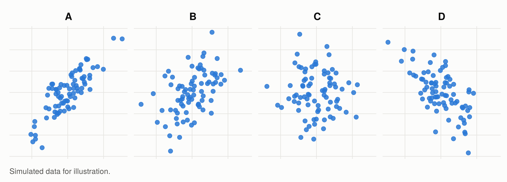{width="100%"}

## Correlation: the answers {.smaller}

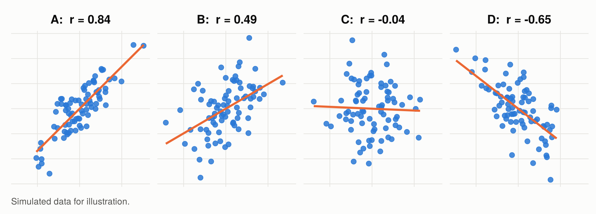{width="100%"}

::: {.notes}
~2 min across these two slides. Most people underestimate moderate correlations like B. r = 0.35 is a real but noisy relationship, and many social-science relationships look like B.
:::

## Correlation requires variation

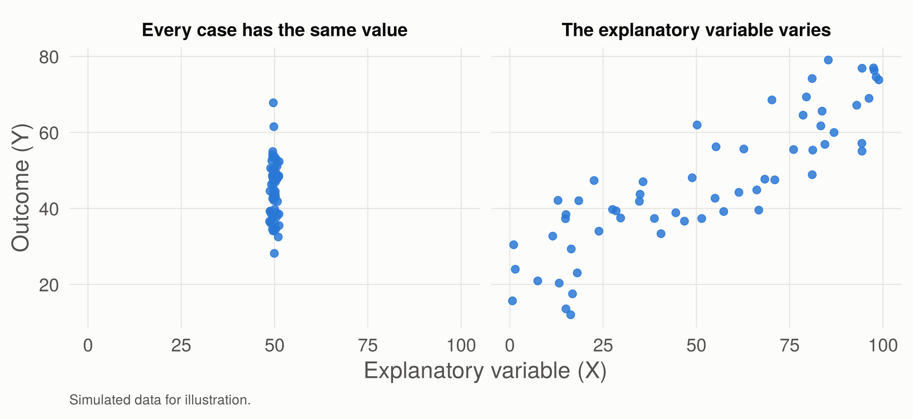{width="78%" fig-align="center"}

::: {.keyidea}
**To explain a difference, you need a difference.** If every country in your data is an AOSIS member, your data cannot tell you what AOSIS membership does.
:::

::: {.notes}
~1 min. Practical implication for paper design: choose cases that vary on the thing you care about.
:::

## Too little variation hides relationships

:::: {.columns}
::: {.column width="62%"}
::: {.r-stack}
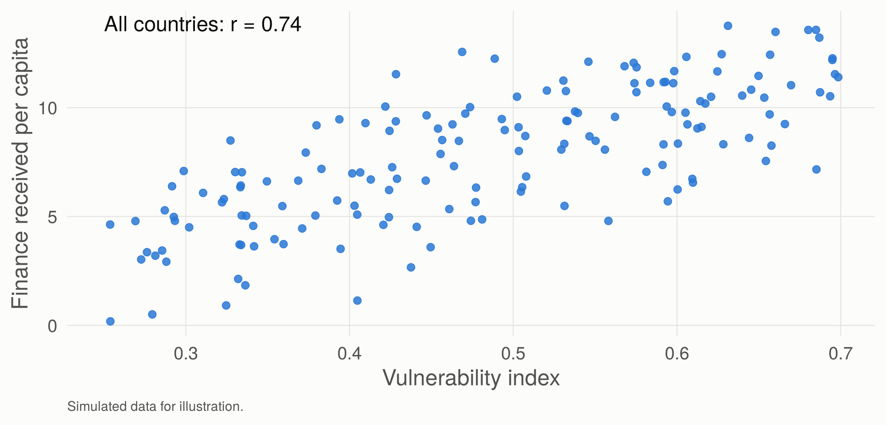{width="100%"}

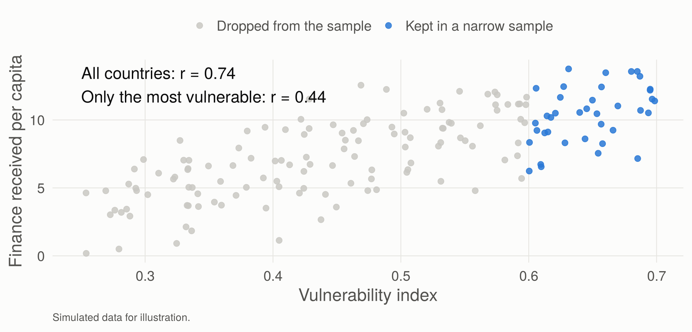{.fragment width="100%"}
:::
:::
::: {.column width="38%"}
::: {.fragment}
Cutting the range of *X* weakens the visible relationship, even though the underlying pattern is the same.

 

**Ask of any dataset:** who got left out?

- Only countries that *received* finance?
- Only initiatives that *survived*?
- Only events that were *registered*?
:::
:::
::::

::: {.notes}
~1.5 min. This sets up Tennant later: eligibility (who gets any finance) vs amount. If you only look at recipients you can miss the selection stage.
:::

## Correlation is not causation: three reasons {.smaller}

:::: {.columns}
::: {.column width="33%"}
**1. Confounding**

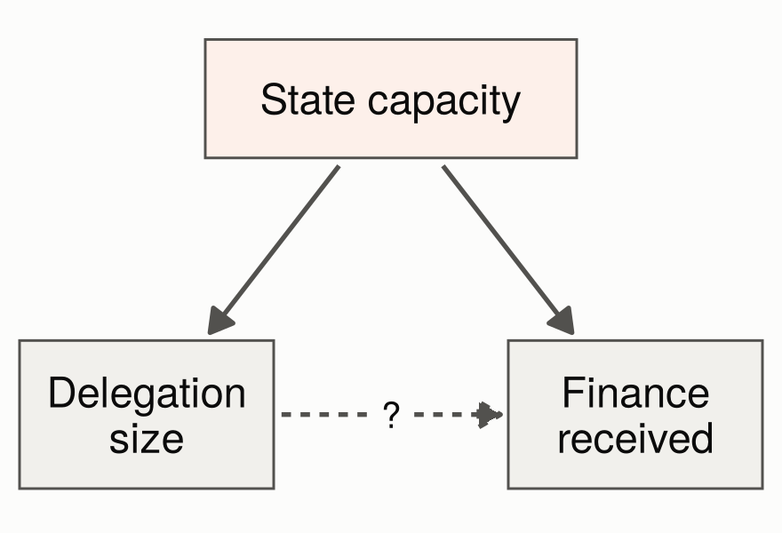{width="100%"}

A third factor drives both.
:::
::: {.column width="33%"}
**2. Reverse causality**

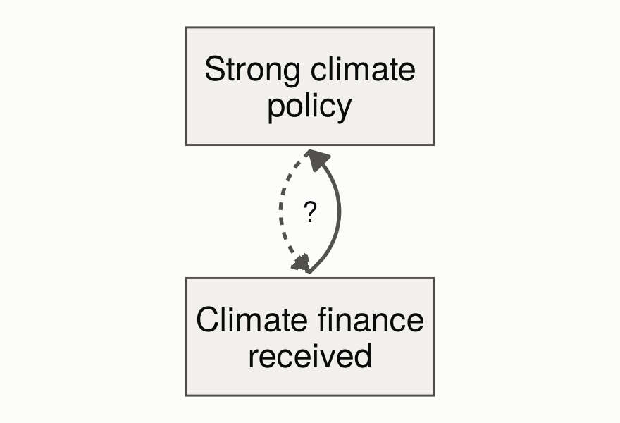{width="100%"}

The outcome may cause the "cause."
:::
::: {.column width="33%"}
**3. Selection**

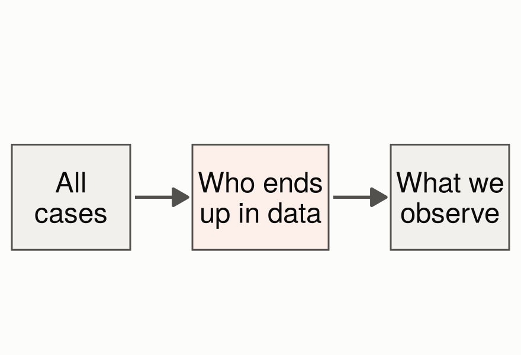{width="100%"}

Cases in the data are not a fair picture of all cases (e.g., only firms that *choose* to disclose emissions).
:::
::::

## Confounding, in pictures

::: {.r-stack}
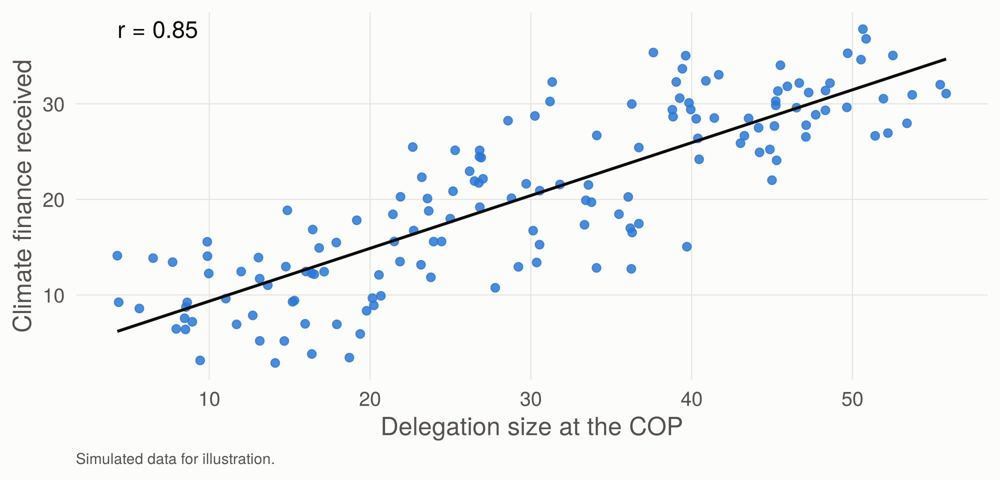{width="72%"}

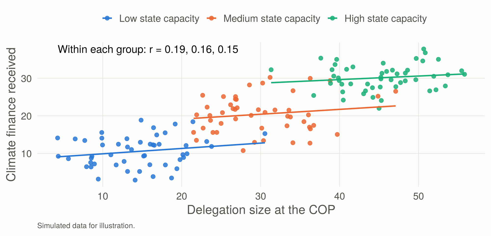{.fragment width="72%"}
:::

::: {.fragment}
"**Controlling for**" state capacity means **comparing like with like**. It only works for confounders you *thought of* and *measured*, and it cannot fix reverse causality.
:::

::: {.notes}
~1.5 min. Pooled: strong positive. Split by capacity: relationship mostly disappears. This is what regression "controls" do, conceptually.
:::

## Where do credible causal claims come from? {.smaller}

The core problem: we never see the **same country** both with and without the "treatment."

Credible designs find a **fair comparison** instead:

| Design | The idea | Environmental-politics example |
|---|---|---|
| **Randomized experiment** | Chance decides who is treated | Payments to forest owners, randomized across Ugandan villages, reduced deforestation (Jayachandran et al. 2017) |
| **Natural experiment** | Nature or history assigns "treatment" as if by chance | Rainfall shocks used to study economic growth and civil conflict (Miguel, Satyanath & Sergenti 2004) |
| **Difference-in-differences** | Compare the *change* in treated vs. untreated units | French manufacturing firms covered by the EU ETS vs. similar uncovered firms, before and after carbon pricing: regulated firms cut CO~2~ by 14–16% (Colmer et al. 2025) |
| **Regression discontinuity** | Compare cases just above vs. just below a cutoff | *Design idea:* countries just above vs. just below an income threshold for concessional finance |

. . .

::: {.keyidea}
**Credibility comes from the design**, meaning how the comparison was set up, more than from adding control variables.
:::

::: {.notes}
~4 min. Don't teach the methods; teach that they exist and what they buy you. Vanden Eynde & Vargas (Class 12) review this kind of evidence on climate and conflict.
Colmer, Martin, Muûls & Wagner (2025), "Does Pricing Carbon Mitigate Climate Change? Firm-Level Evidence from the European Union Emissions Trading System," Review of Economic Studies 92(3): 1625–1660 (advance access May 2024). Matched difference-in-differences on French administrative data; 14% (phase I) and 16% (phase II) reductions, no detectable drop in output or employment. Verified against the open-access PDF.
:::

## What this means for your data paper

::: {.keyidea}
A careful **description** or **correlation** is a full, legitimate contribution. Just **say what you found, not more**.
:::

| Instead of… | Write… |
|---|---|
| "Vulnerability **causes** countries to receive more finance." | "More vulnerable countries **received more** finance on average." |
| "Delegation size **drives** influence." | "Larger delegations **are associated with**…" |
| "This **proves**…" | "This **is consistent with**… but could also reflect…" |

Name **one alternative explanation** you can't rule out. That is what your prompt means by *"what you can and cannot conclude."*

## Samples and populations {.smaller}

:::: {.columns}
::: {.column width="45%"}
- **Population:** every case you want to learn about
- **Sample:** the cases you actually observe
- Any statistic from a sample (a mean, a correlation) would come out **a bit different** with a different sample

 

Let's watch that happen with a simulated "world" of 150 countries →
:::
::: {.column width="55%"}
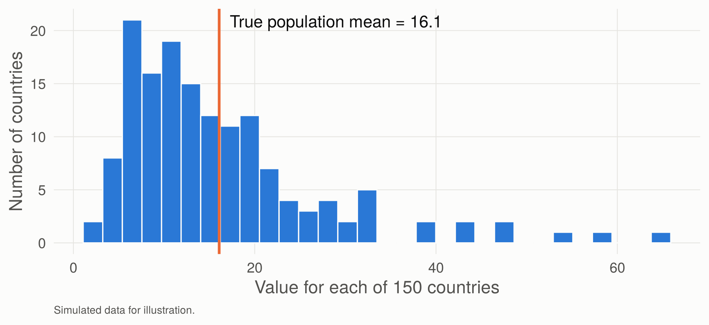{width="100%"}
:::
::::

## Different samples, different answers

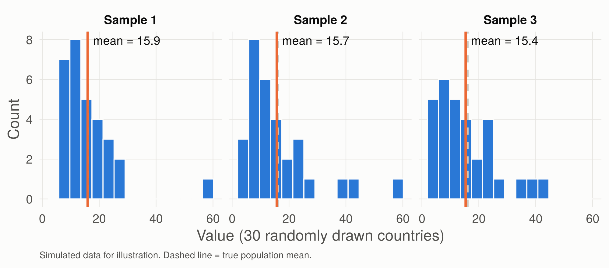{width="76%" fig-align="center"}

. . .

Three random samples of 30 countries give **three different means**. None of them is "wrong."

## The spread of possible answers is the uncertainty

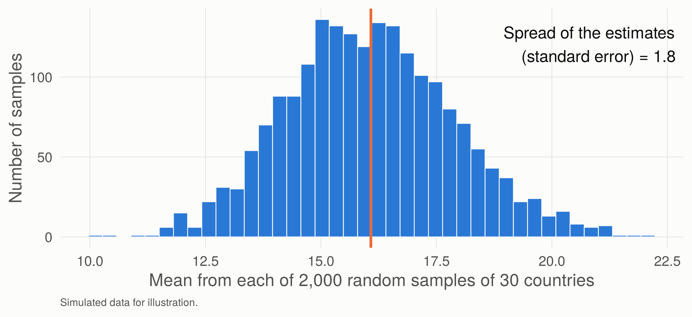{height="420px" fig-align="center"}

The **standard error** measures how much an estimate would bounce around from sample to sample. Bigger samples → smaller standard errors.

## Confidence intervals and p-values {.smaller}

:::: {.columns}
::: {.column width="58%"}
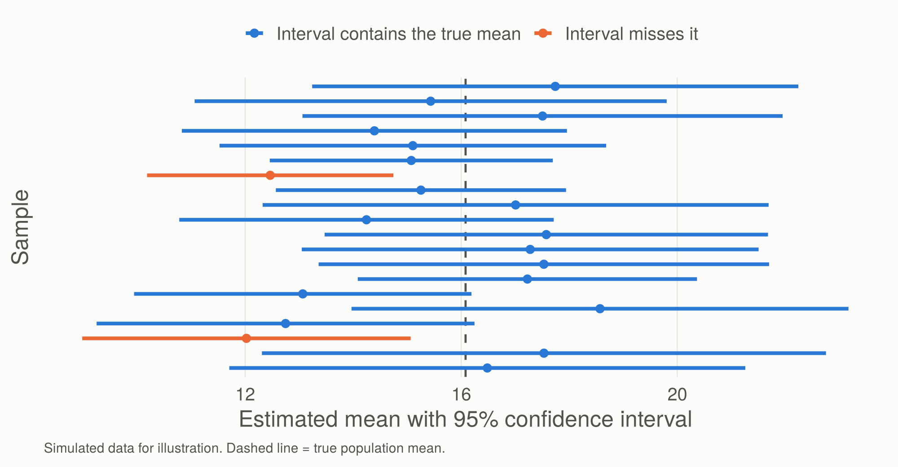{width="100%"}
:::
::: {.column width="42%"}
**95% confidence interval:** a procedure that captures the true value in about 95% of samples. *(Here, 18 of 20 do.)*

**p-value:** if there were really **no** relationship, how often would chance alone produce one at least this strong?

[A p-value is **not**…]{.accent}

- the probability your hypothesis is true
- a measure of how big or important the effect is
:::
::::

::: {.notes}
~3 min for the whole samples sequence. Statistical significance ≠ substantive significance.
:::

## A puzzle: what if you already have every country?

Many datasets in this course cover **(almost) every country**: OECD climate finance, UNFCCC participant lists, every COP side event.

. . .

Then what does a p-value mean?

- Treat the data as **one realization** of an ongoing process (this year's allocations could have come out differently)
- Or treat the analysis as **descriptive**: you are reporting what happened, not estimating a hidden truth
- Either way, **measurement error** and **who is missing** still matter

::: {.notes}
~1 min. No single right answer. Plant the seed; it comes back with Tennant.
:::

## Recap: six ideas to carry into the papers

1. Numbers are **measurements of concepts**. Every step from concept to number is a choice.
2. Good questions are **specific, answerable, and about variation**.
3. Correlation **needs variation**, and who is **left out** of the data shapes what you see.
4. Correlation ≠ causation: **confounding, reverse causality, selection**.
5. Credible causal claims come from **design**, not from adding controls.
6. Every estimate comes with **uncertainty**. Report it honestly and keep statistical and substantive significance apart.

# Part 1B · Measure → Map → Model {.divider}

Three readings, three steps in quantitative work

## Three steps, three papers

::: {.mmm .big}
::: {}
[Measure]{.mmm-h}

*What is it, and how do we count it?*

**Fransen et al. (2023)** The implementation gap in climate policy
:::
::: {}
[Map]{.mmm-h}

*How is it distributed? What patterns appear?*

**Xie et al. (2025)** Inclusivity at COP side events
:::
::: {}
[Model]{.mmm-h}

*What explains it, and how sure are we?*

**Tennant et al. (2024)** Access to climate finance for SIDS
:::
:::

 

::: {.activity}
**Small groups of 3–4.** Everyone has read all three papers. For each paper, every group discusses the **same prompts** for about 4 minutes, then we hear from a few groups (2–3 minutes).
:::

::: {.notes}
~1 min. Form groups of 3–4 now and keep them for all three papers. Each part builds on the one before: you can't map what you haven't measured, or model what you haven't mapped. Report-outs: call on a different group each time; ask the others to add only what's new.
:::

## Measure · Fransen et al. (2023) {.smaller}

::: {.mmm}

Measure

Map

Model

:::

**The concept:** the climate policy **implementation gap**. The authors split it into two parts:

- **Policy adoption gap:** pledges vs. projected emissions under *adopted* policies (Climate Action Tracker estimates)
- **Policy outcome gap:** what adopted policies *should* achieve vs. what they actually achieve. **It cannot be measured directly**, so they compare policy-strength scores with later outcomes (CCPI)

:::: {.columns}
::: {.column width="50%"}
**Who makes these numbers?**

- *Climate Action Tracker:* Climate Analytics & NewClimate Institute
- *CCPI:* Germanwatch, NewClimate Institute & CAN, partly from **expert assessments**
:::
::: {.column width="50%"}
**Why it's a model paper for you**

- A careful **descriptive** paper
- Openly says the outcome gap is a **proxy**
- Time windows differ across its figures (2014–19, 2018–22, 2023)
:::
::::

## Measure · Discuss in your group {.smaller}

::: {.activity}
**Warm-up, 3 minutes.** As a group, pick one concept. Write down: **(1) an indicator, (2) a data source, (3) one thing your indicator misses.**
:::

:::: {.columns}
::: {.column width="50%"}
- **Climate ambition** of a country
- **State capacity** to implement climate policy
- **Inclusivity** of a COP
- **Vulnerability** to climate change
:::
::: {.column width="50%"}
::: {.fragment}
**Then discuss Fransen et al. (4 min), and we'll hear from a few groups:**

1. How did Fransen et al. get a number for something that "can only be measured after the fact"?
2. **Validity:** does a CCPI policy score capture *implementation*?
3. **Reliability:** would different experts score the same country the same way?
4. Where does the outcome gap show up in the data? *(Hint: in the variation around the expected diagonal.)*
:::
:::
::::

::: {.notes}
~12 min total for Measure: ~3 min paper intro, 3 min warm-up, 4 min group discussion, 2–3 min report-out. Collect 2–3 indicators per concept on the board. Then compare: Xie measures inclusivity; Tennant uses vulnerability indices. Key teaching points: validity vs reliability; comparability across countries; numbers made by NGOs/think tanks have their own choices built in.
:::

## Map · Xie et al. (2025) {.smaller}

::: {.mmm}

Measure

Map

Model

:::

:::: {.columns}
::: {.column width="55%"}
**The data:** UNFCCC records of every COP side event, **COP9–COP28 (2003–2023)**: titles, descriptions, host organizations, and who nominated participants

**The methods:**

- **Topic modelling** (machine learning on event text) to trace themes such as energy, food and forests
- **Network analysis** of who co-hosts energy events with whom (COP17–28)

**The pattern:** fossil-fuel lobbyists gain access through business NGOs and some governments, and sit at the **edge** of the anti-fossil-fuel discussion, which grew from a tight network of environmental NGOs.
:::
::: {.column width="45%"}
::: {.keyidea}
This is **"found data"**: administrative records kept for running a conference, repurposed to measure **inclusivity**.

Mapping is a **contribution in itself**. No causal claim is needed to make an important point.
:::
:::
::::

## Map · Discuss in your group

::: {.activity}
**In your group, 4 minutes.** Then a few groups report back (2–3 minutes).
:::

1. **What is one observation?** An event? An organization? A link between organizations?
2. **Population or sample?** Every *registered* side event is included. What isn't?
   - Unregistered events, country pavilions, the negotiating rooms themselves…
3. **How does "inclusivity" become a number?** Topic shares? Network position? What would *you* use?
4. **Variation:** what differs across COPs and across actor groups? Is that enough to compare them fairly?
5. **What can't this paper conclude?** Does a central network position mean **influence** over outcomes?

::: {.notes}
~12 min total for Map: ~4 min paper intro, 4 min groups, 2–3 min report-out. Tie back to the lecture: selection (registered events only), measurement (inclusivity), description as a legitimate end goal. Link to students interested in non-state actors, AOSIS, major powers.
:::

## Model · Tennant, Davies & Tennant (2024) {.smaller}

::: {.mmm}

Measure

Map

Model

:::

:::: {.columns}
::: {.column width="55%"}
**Two questions:**

1. Do donors use **different criteria** to decide *who is eligible* for climate finance than to decide *how much* they get?
2. Do SIDS get more or less finance than **their vulnerability and adaptive capacity justify**?

**Two stages:**

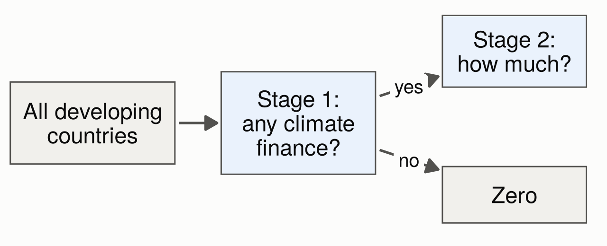{width="100%"}
:::
::: {.column width="45%"}
**Findings (from the abstract):**

- DAC donors use **significantly different criteria** at the two stages
- Low-income SIDS with weak capacities are often **ineligible**, excluded by complex processes, or get **meagre** allocations
- SIDS are **not one group**: the average hides a split

::: {.keyidea}
Remember **restricted range**: study only recipients and you miss stage 1.
:::
:::
::::

## Model · Activity: build the causal diagram

::: {.activity}
**Whole class, 5 minutes.** What else affects how much climate finance a country receives? I'll draw it as you call it out.
:::

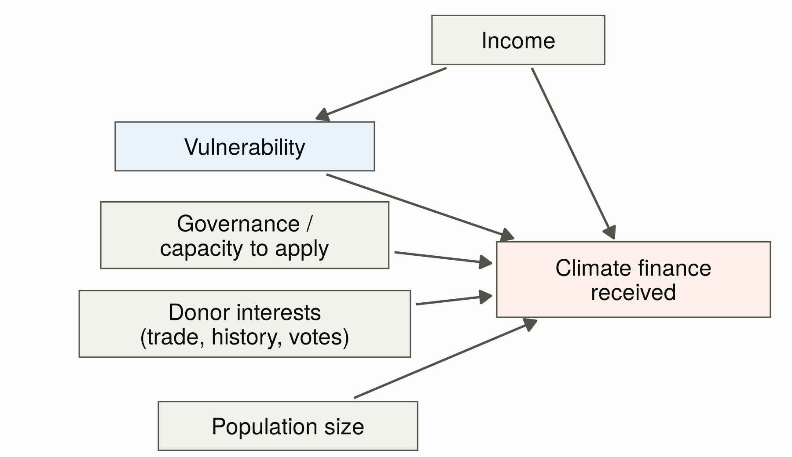{width="72%" fig-align="center"}

[*Starting point. We add arrows together.*]{.tiny}

::: {.notes}
Reveal the diagram after students have offered several factors, or draw on the board first and show this as a comparison. Push on: which of these does Tennant control for? Which could still be lurking? Is anything a consequence of finance rather than a cause (reverse causality: does finance build capacity)?
:::

## Model · Discuss in your group

::: {.activity}
**In your group, 4 minutes.** Then a few groups report back (2–3 minutes).
:::

1. **Measure:** where do the finance numbers come from, and who reports them? *(Donors report to the OECD and tag projects themselves.)*
2. Is "**more than justified by vulnerability**" a causal claim or a comparison? What does "justified" assume?
3. **Confounders:** which factors does the model hold constant? What could still be missing?
4. **Inference:** the data cover nearly every recipient. What do the p-values mean here?
5. **Design:** if you wanted a *causal* answer, what comparison would you look for? *(A sudden disaster? An eligibility cutoff?)*

::: {.notes}
~16 min total for Model: ~4 min paper intro, 5 min diagram, 4 min groups, 2–3 min report-out. This is the most advanced paper; aim for intuition, not estimation details. Connect explicitly to Part 2: students will run a simplified version (vulnerability vs adaptation finance, SIDS vs non-SIDS).
:::

## Three papers, three kinds of claim

| | Measure | Map | Model |
|---|---|---|---|
| **Paper** | Fransen et al. | Xie et al. | Tennant et al. |
| **Kind of claim** | *There is a gap, and here is its size* | *Here is who is where* | *These factors predict who gets what* |
| **Main risk** | Validity of proxies | Who is missing | Confounding; meaning of inference |
| **Lecture idea** | Concept → number | Variation and selection | Correlation ≠ causation; uncertainty |

::: {.keyidea}
Your data paper will probably sit in **Measure** and **Map**, perhaps with a careful step toward **Model**. That is exactly the right scope.
:::

# Part 1C · Your question ladder {.divider}

From topic to a question your data can answer

## Before you climb: where is your variation?

Every question type needs something that **differs**. Find yours before you pick a question.

| Question type | The variation you need |
|---|---|
| **Change** | The same measure in several years |
| **Distribution** | Many units that receive or have different amounts |
| **Comparison** | At least two groups (or periods), with several cases in each |
| **Composition** | A total that splits into parts, and parts that differ in size |
| **Relationship** | Variation in **both** the outcome (*Y*) **and** the predictor (*X*) |

::: {.notes}
~1 min. A relationship question needs both X and Y to vary across the same cases. If your outcome barely varies (every country signed the treaty), there is nothing to explain.
:::

## Where variation comes from, by primary focus

| Your primary focus | Typical unit (one row) | Variation often comes from… |
|---|---|---|
| **Actor** (China, AOSIS, a firm) | Actor-year, or the actor vs. peers | Over time; comparison with similar actors |
| **IO / institution** (GCF, World Bank) | Project or recipient | Across projects, recipients, sectors, years |
| **Issue** (adaptation, deforestation) | Country or country-year | Across countries and over time |
| **Instrument / policy** (NDCs, carbon pricing) | Country or country-year | Adopters vs. non-adopters; before vs. after |

::: {.keyidea}
**One actor = no variation across cases.** Get it from time, a comparison group, or the parts of a total.
:::

::: {.notes}
~1.5 min. The trap: one actor (say, China) gives no cross-sectional variation, so you need time, a comparison group, or a breakdown into parts. Both tables are on the question-ladder worksheet.
:::

## Climb the ladder

:::: {.columns}
::: {.column width="50%"}
| Rung | Example |
|---|---|
| **Topic** | Climate finance for small islands |
| **Concept** | Access to adaptation finance |
| **Measure** | Adaptation-related development finance per capita (OECD), 2015–2022 |
| **Pattern** | Does it vary across SIDS by income level? |
| **Question** | Did lower-income SIDS receive less adaptation finance per capita than higher-income SIDS, 2015–2022? |
:::
::: {.column width="50%"}
::: {.activity}
**Individually, 5 minutes:** write your own five rungs.

**In your group, 4 minutes:** swap. Your partners check:

- Is the measure available?
- What **varies**: over time, across units, or both? *(For relationships: do X **and** Y vary?)*
- What **can't** you conclude?
:::

A few volunteers share *(2 min)*.
:::
::::

::: {.notes}
~10 min (~12 with the variation slide). Hand out the question-ladder worksheet. Collect ladders (photo or a shared doc) so you can tailor Part 2 examples. The example question is a Comparison question. Point out that it's descriptive and answerable.
:::

## After the break {.divider}

Bring your question ladder. We'll work with real data:

**summary statistics → one good figure → one statistical test**

[Break 2:30–2:45 · Lab starts at 2:45. Open RStudio during the break and come find me if anything isn't working.]{.muted}
